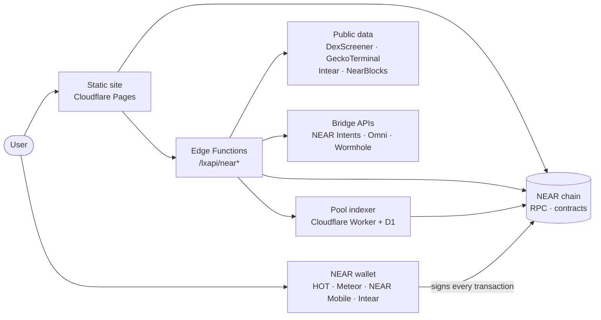

<div align="center">


# LumosCore on NEAR

**Non-custodial trading, liquidity and cross-chain transfers on NEAR Protocol.**

[](https://lumoscore.com/trade/near)
[](https://near.org)
[](https://pages.cloudflare.com)
[](LICENSE)

[**Open the app**](https://lumoscore.com/trade/near) · [Pools](https://lumoscore.com/pools/near) · [Bridge](https://lumoscore.com/bridge/near) · [LUMOS token](https://lumoscore.com/lumos/near)

</div>

---

## Overview

LumosCore is a multi-network DeFi platform: one site, one design, a separate build per network. This repository is
its **NEAR Protocol** build. It covers swaps, limit orders, liquidity pools, cross-chain bridging, a wallet view, a
token launchpad and LUMOS rewards, served as a static site with a thin edge layer on Cloudflare.

> **Your keys never leave your wallet.** Every action is a transaction you approve in your own NEAR wallet.
> LumosCore holds no keys, takes no custody and runs no account system.

## Features

| | |
|---|---|
| **Trade** | Token pages with live price, charts, holders, pools and recent trades. Swaps routed through NEAR's exchange contracts, plus limit orders on the on-chain order book. |
| **Pools** | Every curated pool with liquidity, 24h volume and fees. Create a pool, add or withdraw liquidity, and browse the **Rewarded Pools** that earn LUMOS. |
| **Bridge** | Move assets to 35 networks over **NEAR Intents**, **Omni Bridge** and **Wormhole**, with each route's fees and timing shown up front, and claims handled in the app where a route needs one. |
| **Wallet** | Balances, send and receive, LP positions, open orders (cancel, collect, claim) and a decoded activity history. |
| **Launchpad** | Create and launch a NEAR token end to end. |
| **Rewards** | The LUMOS Native LP, Ecosystem LP and Whale Holder programmes. |
| **Dashboard** | Network stats, markets and live Platform Activity. |

**Supported wallets:** HOT, Meteor, NEAR Mobile and Intear, connected through NEAR Connect.

## Architecture



- **Static site.** Every page is pre-built HTML with its NEAR logic injected as layers, served from Cloudflare Pages.
- **Edge Functions.** A thin layer that caches public data, shields upstreams from rate limits and never holds user
  funds or keys.
- **Pool indexer.** A Worker that records every pool's swaps, deposits and withdrawals into D1 each minute, for pool
  histories and provider counts no public API offers.
- **Honest data.** Every figure is read live from the chain or a public source. A value that cannot be read is shown
  as unknown, never as zero.

## Data sources

| Source | Used for |
|---|---|
| NEAR RPC and FastNEAR | Balances, contract state, transaction history |
| `v2.ref-finance.near`, `dclv2.ref-labs.near` | Pools, swaps, the order book, limit orders |
| DexScreener, GeckoTerminal | 24h volume, candles, recent trades |
| Intear | Token search, prices and holder counts |
| NearBlocks | Explorer links, token metadata fallbacks |
| NEAR Intents, Omni Bridge, Wormhole | Bridge quotes, transfer status, claims |

## Getting started

The pages are generated from LumosCore's **design containers**, large HTML sources shared with the Stellar build.
They are not in this repository (about 120 MB, and the product's design source), so a full build needs them and a
checkout of the [Stellar repository](https://github.com/RazaRizv1/lumoscore), whose shared edge Functions are kept in
step through `shared-functions.json`.

```bash
npm run rebuild      # run every NEAR transform, in order, over the containers
npm run build        # shared Functions, baked data, then dist/near
npm run predeploy    # pre-deploy checks
npm run idem         # two consecutive runs must produce byte-identical output
```

The deployed site is a single tree that combines the Stellar, XRPL and NEAR builds; it is assembled outside this
repository.

## Project structure

```text
_tools/                    build: rebuild.js runs the transform chain, extract_site.js writes the site
  _near*.js                one transform per concern (pools, bridge, rewards, FAQ, copy...)
  browser/                 the page layers: swap, bridge, pools, wallet, search, charts...
functions/lxapi/near*.js   Cloudflare Pages Functions for NEAR data
workers/near-pool-indexer/ Cloudflare Worker + D1: pool swaps, deposits, withdrawals
contracts/                 launchpad contracts (token, factory, router)
assets/                    self-hosted NEAR Connect bundle and pinned wallet list
docs/                      images for this README
RELEASE.md                 production release checklist
```

## Security

- **Non-custodial by design.** No code path can move funds; every write is a transaction the user signs.
- **No secrets in the repository.** API keys live as Cloudflare secrets (`wrangler secret put`) and `.env*` is ignored.
- **Hostile input handled as such.** Token names and symbols come from contracts anyone can deploy, so they are
  rendered as text, never as HTML.

Found a vulnerability? Please report it privately through [lumoscore.com/support](https://lumoscore.com/support)
rather than opening a public issue.

## Related repositories

| Network | Repository |
|---|---|
| Stellar (and the shared edge Functions) | [RazaRizv1/lumoscore](https://github.com/RazaRizv1/lumoscore) |
| NEAR | **This repository** |

## License

Released under the [MIT License](LICENSE).
